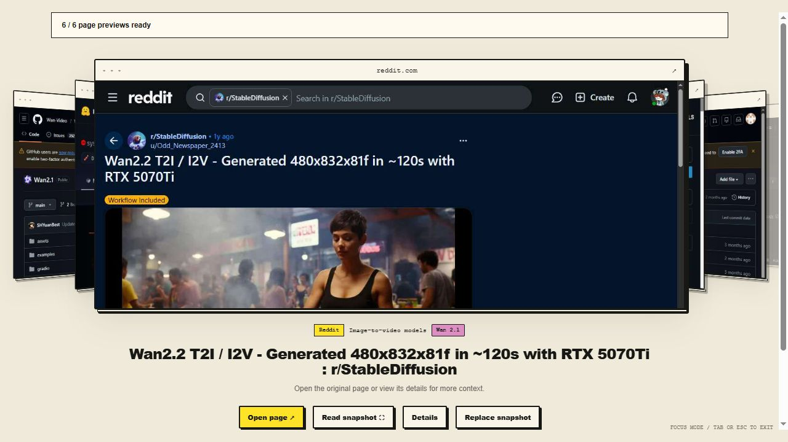
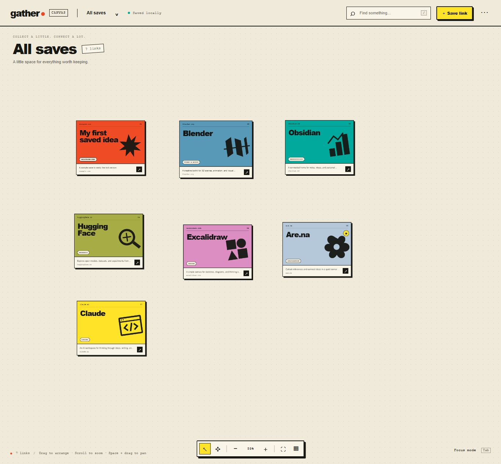
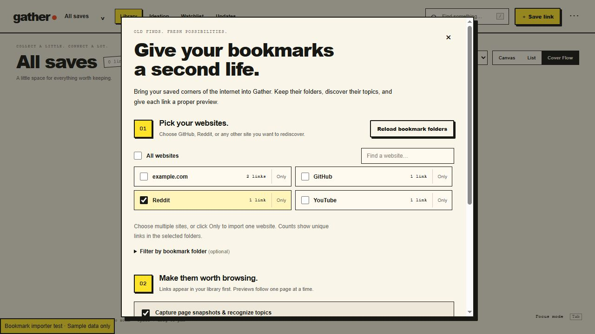
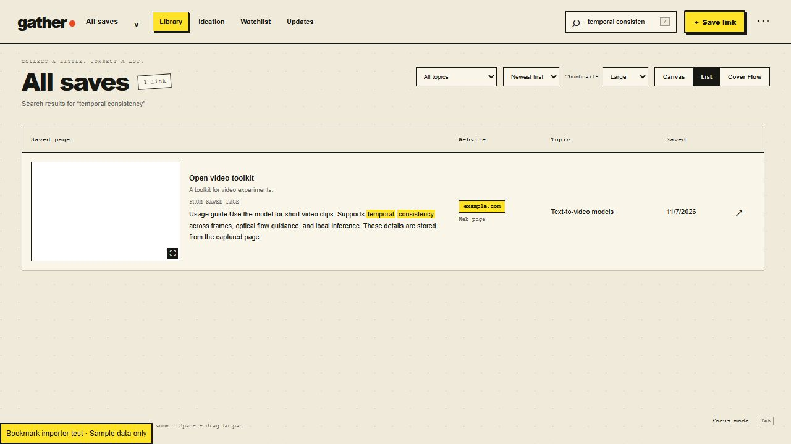
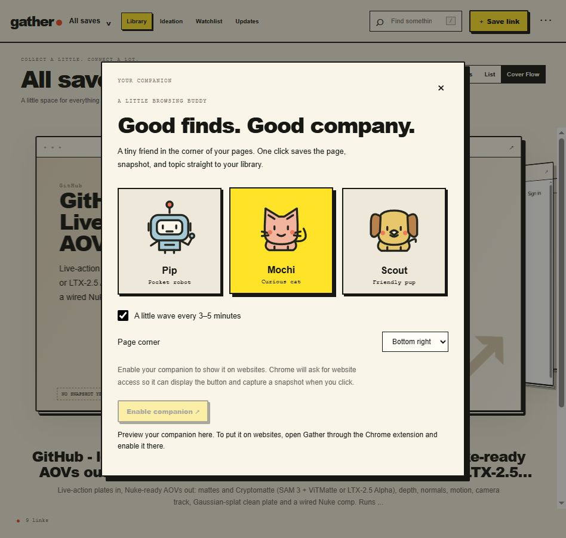
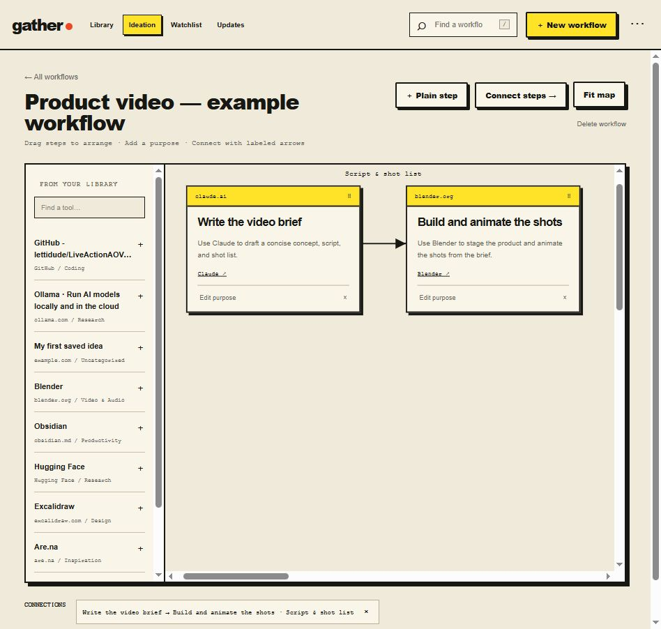

# Gather v0.1

**Turn your saved links into a searchable visual library.** Gather categorizes pages by website and content, captures visual previews, and helps you connect useful tools, articles, and inspiration.



## Features

- Save pages with a shortcut, the Chrome toolbar, or a floating pet or robot companion.
- Import Chrome bookmarks and select the websites or folders you want.
- Organize links by website and specific topics, including video and image model types.
- Capture webpage snapshots and browse them in Canvas, List, or Cover Flow.
- Search titles, websites, tags, notes, and captured page text.
- Connect saved tools into visual workflow maps on the Ideation page.
- Watch individual public pages for text changes, with optional keyword filters.
- Export your library with screenshots and schedule folder backups every 12 hours.

Topic recognition uses local rules. No AI account or API key is required.

## Install the Chrome extension

1. Download this repository using **Code → Download ZIP**, then extract the ZIP to a permanent folder. You can also clone it with Git.
2. Open Chrome and enter `chrome://extensions` in the address bar.
3. Enable **Developer mode** in the upper-right corner.
4. Click **Load unpacked** and select the **extension** folder inside the extracted project. Select `extension`, not the project root or ZIP file.
5. Open Chrome's **Extensions** menu and pin **Gather v0.1**.
6. Open Gather from the toolbar and click **Open your collection**.
7. Visit an ordinary webpage and press **Alt + Shift + S** to save its snapshot and readable text.

The prepared `extension/` folder is included. Keep it in the same location after installation. After editing the source, regenerate it on Windows:

```powershell
powershell -ExecutionPolicy Bypass -File .\build-extension.ps1
```

Then click **Reload** on Gather's card at `chrome://extensions`. Reload the existing extension rather than removing it to retain its collection.

## Run the local app and services

The extension supports ordinary capture without a server. The local Python server adds page reading for the web app, Watchlist checks, folder backups, and extension reinstall recovery.

1. Install Python 3.10 or later from [python.org](https://www.python.org/downloads/). On Windows, enable **Add Python to PATH** in the installer.
2. Open a terminal in the extracted project folder.
3. Run:

   ```powershell
   python server.py
   ```

   Use `python3 server.py` if that is your system's Python command.

4. Open [http://localhost:4173](http://localhost:4173).
5. Keep the terminal running for checks, backups, and recovery syncing. Press **Ctrl + C** to stop it.

No Python dependencies are required. If port 4173 is in use, run `python server.py --port 4174` instead.

The localhost app and Chrome extension have separate collections. Open the extension's own collection to see pages captured through Chrome.

## First things to try

**Import bookmarks:** In the extension popup, choose **Import bookmarks**. Load bookmarks, select websites, leave snapshot capture enabled if you want previews, and click **Import selected bookmarks**. Chrome may request access and show a debugging notice while pages are captured in an inactive tab.

**Choose a companion:** Expand **Choose your companion** in the extension popup, pick Pip, Mochi, or Scout, and select **Enable companion**. Click it on a webpage to save the page.

**Browse and search:** Switch between Canvas, List, and Cover Flow. Use arrow keys to flip through Cover Flow. Search for a website such as `reddit`, a tool name, or a keyword from captured text.

**Set up backups:** Start the Python server. Open **Collection settings → Backups**, choose a folder, and use **Back up now**. Automatic backups run every 12 hours while the server and computer are running.

See the [installation and troubleshooting guide](docs/INSTALL.md) and [full user guide](docs/USER-GUIDE.md).

## Screenshots

These screenshots show example collections. Some were captured during development and may show earlier labels.

| Canvas library | Bookmark import by website |
| --- | --- |
|  |  |

| Keyword search in captured text | Companion choices |
| --- | --- |
|  |  |



## Storage and current limits

- The library stays in browser storage. Local backup and watch data live in `.gather/` beside the server.
- **Export library + screenshots** includes images and captured text in an importable JSON file.
- Uninstalling can remove extension storage. Keep an export or confirm server recovery syncing before uninstalling.
- Snapshots capture a viewport, not the entire scrollable page. Restricted or blocked pages may need manual review.
- Search covers saved readable text, up to 12,000 characters per page. It does not perform OCR on images.
- Watchlist checks public pages for text changes. It does not crawl entire websites or execute workflow maps.
- Folder backups currently use a Windows folder picker. Scheduled services run while the local server is running.

## Development and checks

Gather uses plain HTML, CSS, JavaScript, and Python's standard library. Node.js is only needed for JavaScript tests.

```powershell
node --test tests/*.test.cjs
python -m unittest discover -s tests -p "test_*.py"
```

Build a clean source-and-extension ZIP with `python prepare-release.py`. Personal library exports, recovery data, videos, and design references are excluded.

**Less hunting. More making.**
